# 08. Statistics — One Dataset, Every Formula

> **Companion to [08-statistics.md](08-statistics.md).** This file uses one small dataset, [08-statistics-students.csv](08-statistics-students.csv), and works through every formula from the topic file by hand, step by step, so you can see what each one *means* on real numbers.
>
> All results were checked with `scipy`. Rounded values are given to 2–4 decimals.
>
> **Graphs:** every picture is drawn by a small Python script in [`scripts/08-statistics/`](scripts/08-statistics/) (one script per graph, shared style in [`common.py`](scripts/08-statistics/common.py)). See [Regenerating the graphs](#regenerating-the-graphs).

## Contents
0. [The dataset](#0-the-dataset)
1. [Descriptive statistics](#1-descriptive-statistics) — incl. **[1.3 Outliers, explained](#13-outliers-explained-quartiles-iqr-fences)**
2. [Expectation, variance, higher moments](#2-expectation-variance-higher-moments)
3. [Normal distribution and standardization](#3-normal-distribution-and-standardization)
4. [Estimators and unbiasedness](#4-estimators-and-unbiasedness)
5. [Confidence intervals](#5-confidence-intervals)
6. [Hypothesis tests and p-values](#6-hypothesis-tests-and-p-values)
7. [Parametric tests](#7-parametric-tests)
8. [Non-parametric tests](#8-non-parametric-tests)
9. [Summary: which question → which formula](#9-summary)
10. [Regenerating the graphs](#regenerating-the-graphs)

---

## 0. The dataset

**Story.** 12 students prepare for an exam with one of three study methods (Lecture, Video, Group). Each writes a test **before** and **after** a 4-week course. We record how many hours per week they studied and how many classes they missed. A student **passed** if the after-score is at least 60.

| id | name | gender | method | study_hours | score_before | score_after | absences | passed |
|---|---|---|---|---|---|---|---|---|
| 1 | Anna | F | Lecture | 2 | 52 | 55 | 3 | no |
| 2 | Ben | M | Lecture | 4 | 58 | 62 | 1 | yes |
| 3 | Clara | F | Lecture | 3 | 50 | 57 | 2 | no |
| 4 | David | M | Lecture | 1 | 45 | 48 | 4 | no |
| 5 | Emma | F | Video | 5 | 60 | 68 | 1 | yes |
| 6 | Felix | M | Video | 6 | 63 | 70 | 0 | yes |
| 7 | Greta | F | Video | 4 | 55 | 64 | 2 | yes |
| 8 | Hans | M | Video | 3 | 61 | 59 | 1 | no |
| 9 | Ida | F | Group | 7 | 65 | 76 | 0 | yes |
| 10 | Jonas | M | Group | 4 | 61 | 66 | 1 | yes |
| 11 | Lena | F | Group | 6 | 62 | 73 | 0 | yes |
| 12 | Max | M | Group | 12 | 70 | 94 | 0 | yes |

**Which column is used for which topic**

| Column | Type | Used for |
|---|---|---|
| `score_after` | continuous | descriptive stats, moments, z-scores, CI, one-sample tests, normality check |
| `study_hours` | continuous | outliers, correlation/regression (with `score_after`), MLE |
| `score_before` → `score_after` | paired | paired $t$, sign test, Wilcoxon signed-rank |
| `gender` | 2 groups | two-sample $t$, $F$-test, Mann–Whitney U |
| `method` | 3 groups | ANOVA, Kruskal–Wallis, $\chi^2$ independence (with `passed`) |
| `absences` | discrete counts | expectation/variance of a discrete distribution, Poisson MLE |
| `passed` | yes/no | proportion CI, contingency table |

$n=12$ throughout.

---

## 1. Descriptive statistics

### 1.1 Centre of `score_after`
Sorted: $48,55,57,59,62,64,66,68,70,73,76,94$

| Measure | Calculation | Result |
|---|---|---|
| mean | $\bar x=\frac{792}{12}$ | **66** |
| median | $n$ even → average of 6th and 7th: $\frac{64+66}2$ | **65** |
| mode | every value appears once | **no mode** |

For `study_hours` (sorted $1,2,3,3,4,4,4,5,6,6,7,12$): mean $\frac{57}{12}=4.75$, median $\frac{4+4}2=4$, mode $=4$ (appears 3×).

**Meaning:** a typical student scored about 65–66 after the course. The mean (66) is a bit above the median (65) because of one very high score (Max, 94) → slight **right skew**.

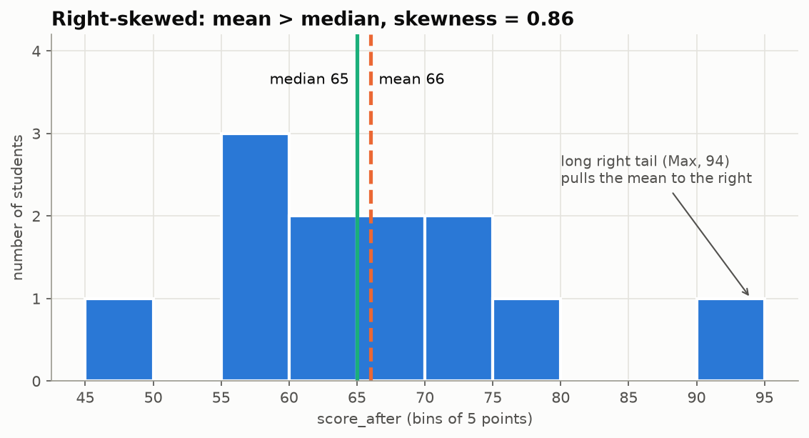
*Graph script: [`scripts/08-statistics/04_histogram_skew.py`](scripts/08-statistics/04_histogram_skew.py)*


### 1.2 Spread of `score_after`
Deviations $x_i-\bar x$ (in id order) and squares:

| id | 1 | 2 | 3 | 4 | 5 | 6 | 7 | 8 | 9 | 10 | 11 | 12 | Σ |
|---|---|---|---|---|---|---|---|---|---|---|---|---|---|
| $x_i$ | 55 | 62 | 57 | 48 | 68 | 70 | 64 | 59 | 76 | 66 | 73 | 94 | 792 |
| $x_i-\bar x$ | −11 | −4 | −9 | −18 | 2 | 4 | −2 | −7 | 10 | 0 | 7 | 28 | **0** |
| $(x_i-\bar x)^2$ | 121 | 16 | 81 | 324 | 4 | 16 | 4 | 49 | 100 | 0 | 49 | 784 | **1548** |

(The deviations always sum to 0 — a quick check.)

| Measure | Calculation | Result |
|---|---|---|
| range | $94-48$ | **46** |
| sample variance | $s^2=\frac{1548}{n-1}=\frac{1548}{11}$ | **140.73** |
| sample SD | $s=\sqrt{140.73}$ | **11.86** |
| (dividing by $n$, for comparison) | $\frac{1548}{12}$ | 129 — smaller, biased |

**Meaning:** a *typical* distance of a score from the mean is about 12 points. (It is not exactly the plain average distance: that is $\frac{102}{12}=8.5$. The SD is larger because squaring gives big distances, like Max's 28, extra weight.)

**Why divide by $n-1=11$ and not $n=12$?** We measure distances from $\bar x$, which is computed from the same 12 scores and therefore sits as close to them as possible; distances to the unknown true mean $\mu$ would be a bit larger. So $\sum(x_i-\bar x)^2$ is slightly too small, and dividing by the smaller number $n-1$ corrects this **on average**. "Biased" means: over many repeated samples, the $\frac1n$ version averages $\frac{n-1}n\sigma^2$ (≈8% too low for $n=12$), while $s^2$ averages exactly $\sigma^2$ (simulation: section 4, graph 14). Extreme case: with $n=1$, dividing by $n$ always gives variance $0$, which is clearly wrong. Rule: **data is a sample → divide by $n-1$.**

### 1.3 Outliers, explained (quartiles, IQR, fences)

**What is an outlier, in plain words?** A value that is *much further from the middle of the data than the rest of the data is*. "Much further" needs a ruler, and the ruler is the **IQR**: the width of the middle half of the students.

**The idea in 4 steps**
1. Find the **middle half** of the data: from $Q_1$ (25% of students are below) to $Q_3$ (75% are below). This is the **box**.
2. Its width $IQR=Q_3-Q_1$ says how spread out a *normal* student is.
3. Allow one and a half box-widths of extra room on each side. These limits are the **fences**:
   $$\text{lower fence}=Q_1-1.5\cdot IQR,\qquad \text{upper fence}=Q_3+1.5\cdot IQR$$
4. Anything **outside the fences** is flagged as an outlier.

Why the median-based IQR and not the SD? Because the outlier itself would inflate the SD and partly hide itself. The quartiles barely react to one extreme value.

**Step by step for `score_after`**
| Step | Calculation | Result |
|---|---|---|
| sort | $48,55,57,59,62,64\ \mid\ 66,68,70,73,76,94$ | two halves of 6 |
| $Q_1$ | median of lower half: $\frac{57+59}2$ | 58 |
| $Q_3$ | median of upper half: $\frac{70+73}2$ | 71.5 |
| IQR | $71.5-58$ | 13.5 |
| allowed extra room | $1.5\cdot13.5$ | 20.25 |
| lower fence | $58-20.25$ | 37.75 |
| upper fence | $71.5+20.25$ | 91.75 |
| check | $48\ge37.75$ ✓ … $76\le91.75$ ✓, **$94>91.75$ ✗** | **Max is an outlier** |

So Max's 94 is outside the fence by $94-91.75=2.25$ points. Everybody else is comfortably inside (the next highest, Ida with 76, is 15.75 points below the fence).

Same for `study_hours`: $Q_1=3$, $Q_3=6$, $IQR=3$, fences $3-4.5=-1.5$ and $6+4.5=10.5$ → **Max's 12 hours is also an outlier**; the next highest is 7.

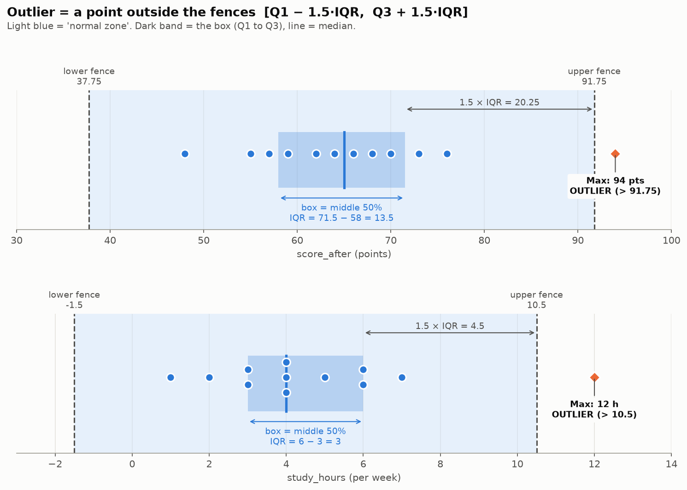
*Graph script: [`scripts/08-statistics/01_outliers_number_line.py`](scripts/08-statistics/01_outliers_number_line.py)*

**The boxplot is just this picture compressed.** The box is $Q_1$–$Q_3$, the line inside is the median, the whiskers go to the **last data point still inside the fences** (here 48 and 76, *not* to the fences themselves), and anything beyond is drawn as a separate dot.

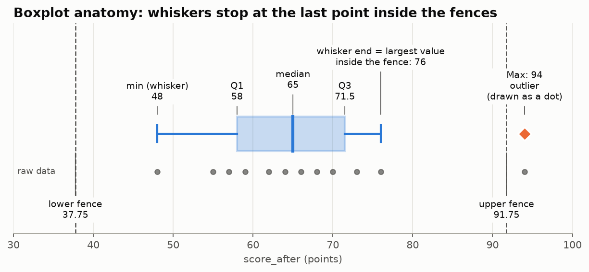
*Graph script: [`scripts/08-statistics/02_boxplot_anatomy.py`](scripts/08-statistics/02_boxplot_anatomy.py)*

**Five-number summary:** min $48$, $Q_1=58$, median $65$, $Q_3=71.5$, max $94$.

**MAD** (another robust spread): $\lvert x_i-65\rvert$ sorted $=1,1,3,3,5,6,8,8,10,11,17,29$ → median $\frac{6+8}2=$ **7**.

**Why do we care? What an outlier does to the statistics.** Remove Max and recompute:

| statistic | with Max | without Max | change |
|---|---|---|---|
| mean | 66.00 | 63.45 | −2.55 |
| median | 65 | 64 | −1 |
| SD $s$ | 11.86 | 8.32 | −3.54 (−30%) |

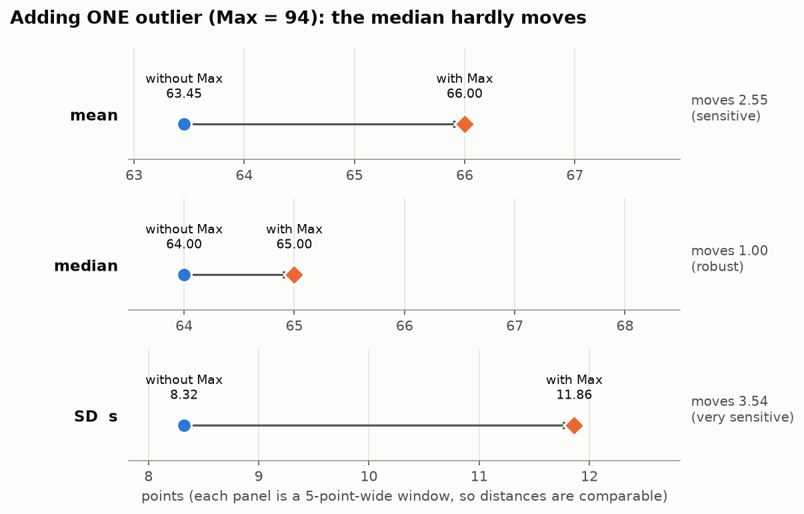
*Graph script: [`scripts/08-statistics/03_outlier_effect.py`](scripts/08-statistics/03_outlier_effect.py)*

One student out of twelve changes the SD by 30%. The median is **robust**; the mean and especially the SD are not.

**What "robust" means, shown with a typo.** Suppose Max's 94 were typed as **940**:

| statistic | correct (94) | typo (940) | robust? |
|---|---|---|---|
| mean | 66 | 136.5 | no: above every real score |
| SD $s$ | 11.86 | 253.16 | no: squares the huge distance |
| median | 65 | 65 | yes: still the middle of the sorted list |
| IQR | 13.5 | 13.5 | yes |
| MAD | 7 | 7 | yes |

Mean and SD use the **size** of every value; median, quartiles and MAD use only the **order**. The top value is still "the top one" whether it is 94 or 940, so order-based statistics don't move.

**Second rule of thumb: z-scores.** $\lvert z\rvert>2$ (some books use 3) means "unusual". Max has $z=2.36$, nobody else exceeds $\lvert z\rvert=1.52$ (see the z-score graph in section 3.1). Both rules point at the same student.

**An outlier is not automatically a mistake.** Before deleting one, ask *why* it is extreme:
- **Data error** (typo 94 instead of 49, wrong unit) → fix or remove.
- **Genuine extreme case** → keep it, but report robust statistics (median, IQR) or use rank-based (non-parametric) tests.

Max is the second kind: he studied 12 h/week, far more than anyone else, and his score fits that (see the scatter plot in 1.5). He is a real, hard-working student, not a typo.

> **Exam shortcut:** compute $Q_1,Q_3$ → IQR → fences $Q_1-1.5\,IQR$ and $Q_3+1.5\,IQR$ → anything outside is an outlier. Example: $Q_1=20,Q_3=30$ ⇒ fences $5$ and $45$.

### 1.4 Linear change
Teacher converts scores to a 0–20 scale: $y=\frac{x}{5}$ ($a=0.2$, $b=0$).
$\bar y=0.2\cdot66=13.2$, $s_y=0.2\cdot11.86=2.37$, median $=13$.
If instead every student gets **+5 bonus points**: mean $71$, SD **unchanged** $11.86$.

### 1.5 Correlation: `study_hours` ($x$) vs `score_after` ($y$)
$\bar x=4.75$, $\bar y=66$.

| id | 1 | 2 | 3 | 4 | 5 | 6 | 7 | 8 | 9 | 10 | 11 | 12 | Σ |
|---|---|---|---|---|---|---|---|---|---|---|---|---|---|
| $x-\bar x$ | −2.75 | −0.75 | −1.75 | −3.75 | 0.25 | 1.25 | −0.75 | −1.75 | 2.25 | −0.75 | 1.25 | 7.25 | 0 |
| $y-\bar y$ | −11 | −4 | −9 | −18 | 2 | 4 | −2 | −7 | 10 | 0 | 7 | 28 | 0 |
| product | 30.25 | 3 | 15.75 | 67.5 | 0.5 | 5 | 1.5 | 12.25 | 22.5 | 0 | 8.75 | 203 | **370** |

$S_{xx}=\sum(x-\bar x)^2=90.25$, $S_{yy}=1548$, $S_{xy}=370$.
$$r=\frac{370}{\sqrt{90.25\cdot1548}}=\frac{370}{373.77}=\mathbf{0.990}$$
**Meaning:** a very strong positive **linear** relationship — students who study more score higher. (It does not prove that studying *causes* the higher score; it is observational data.)

**Least-squares line:** slope $b=\frac{S_{xy}}{S_{xx}}=\frac{370}{90.25}=4.10$ (equivalently $r\frac{s_y}{s_x}=0.990\cdot\frac{11.86}{2.864}$), intercept $\bar y-b\bar x=66-4.10\cdot4.75=46.53$.
$$\hat y=46.53+4.10\,x$$
Each extra hour of study per week ≈ +4.1 points. Prediction for 8 hours: $46.53+32.8=79.3$. The line passes through $(\bar x,\bar y)=(4.75,66)$.

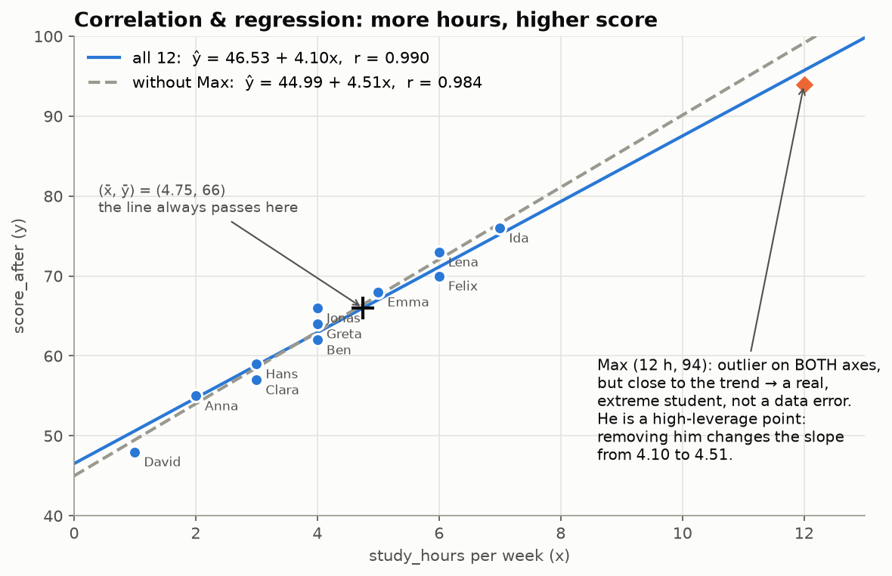
*Graph script: [`scripts/08-statistics/06_scatter_regression.py`](scripts/08-statistics/06_scatter_regression.py)*

**Outlier in two dimensions.** Max is extreme on *each* axis, yet he lies close to the trend, so $r$ barely changes ($0.990$ with him, $0.984$ without). He is a **high-leverage point**: because he is far to the right, he still tilts the line (slope $4.51\to4.10$). An outlier that sat far *off* the line (e.g. 12 h but score 50) would wreck $r$ — always plot the data before trusting a correlation.


---

## 2. Expectation, variance, higher moments

### 2.1 A discrete distribution from `absences`
Treat "absences of a randomly picked student" as a random variable $X$.

**Step 1 — tally the `absences` column** (how many students have exactly $k$ absences):

| $k$ | students with exactly $k$ absences | count |
|---|---|---|
| 0 | Felix, Ida, Lena, Max | 4 |
| 1 | Ben, Emma, Hans, Jonas | 4 |
| 2 | Clara, Greta | 2 |
| 3 | Anna | 1 |
| 4 | David | 1 |
| | total | 12 |

**Step 2 — divide by $n=12$** to get probabilities (picking one student at random, each is equally likely), then multiply:

| $k$ | 0 | 1 | 2 | 3 | 4 |
|---|---|---|---|---|---|
| count | 4 | 4 | 2 | 1 | 1 |
| $P(X=k)$ | 4/12 | 4/12 | 2/12 | 1/12 | 1/12 |
| $k\,P$ | 0 | 4/12 | 4/12 | 3/12 | 4/12 |
| $k^2P$ | 0 | 4/12 | 8/12 | 9/12 | 16/12 |

**What the helper rows mean:** $kP$ = value × its probability; summing the row gives the weighted average $E[X]=\sum k\,P(X=k)$. $k^2P$ = squared value × its probability; summing gives $E[X^2]=\sum k^2P(X=k)$, needed for the variance. (Check: $\frac{15}{12}$ is exactly the total of all absences $3+1+2+4+1+0+2+1+0+1+0+0=15$ divided by 12 students.)

- $E[X]=\frac{15}{12}=\mathbf{1.25}$ absences
- $E[X^2]=\frac{37}{12}=3.083$
- $\operatorname{Var}X=E[X^2]-(E[X])^2=3.083-1.5625=\mathbf{1.521}$, $\sigma=1.233$

**Trap check:** $E[X^2]=3.083\ne(E[X])^2=1.5625$; the difference is exactly the variance.

![Bar chart of the absences distribution with E[X]](images/08-statistics/07-absences-distribution.png)
*Graph script: [`scripts/08-statistics/07_absences_pmf.py`](scripts/08-statistics/07_absences_pmf.py)*


### 2.2 Skewness and kurtosis of `score_after`
Use the population-style moments ($\sigma^2=\frac{1548}{12}=129$, $\sigma=11.358$).

| Moment | Calculation | Result |
|---|---|---|
| 3rd central | $\frac1n\sum(x_i-\bar x)^3=\frac{15060}{12}$ | 1255 |
| 4th central | $\frac1n\sum(x_i-\bar x)^4=\frac{756180}{12}$ | 63015 |
| skewness | $\frac{1255}{11.358^3}=\frac{1255}{1465.2}$ | **0.86** |
| kurtosis | $\frac{63015}{129^2}=\frac{63015}{16641}$ | **3.79** |
| excess kurtosis | $3.79-3$ | **0.79** |

**Meaning:** skewness $>0$ → right-skewed (long right tail, caused by 94), matching mean > median. Excess kurtosis $>0$ → slightly heavier tails than a normal distribution (again the outlier). A perfect normal would give $0$ and $3$.

Same for `study_hours`: skewness $1.26$ (clearly right-skewed, the 12-hour outlier).

---

## 3. Normal distribution and standardization

### 3.1 z-scores (data version) $z_i=\frac{x_i-\bar x}{s}$, $s=11.86$

| name | Anna | Ben | Clara | David | Emma | Felix | Greta | Hans | Ida | Jonas | Lena | Max |
|---|---|---|---|---|---|---|---|---|---|---|---|---|
| score | 55 | 62 | 57 | 48 | 68 | 70 | 64 | 59 | 76 | 66 | 73 | 94 |
| $z$ | −0.93 | −0.34 | −0.76 | −1.52 | 0.17 | 0.34 | −0.17 | −0.59 | 0.84 | 0.00 | 0.59 | **2.36** |

**Meaning:** Max is 2.36 SDs above average — unusual. Jonas is exactly average. Z-scores have mean 0 and SD 1 and have no units, so they let you compare different scales (e.g. Max's hours $z=2.53$ is even more extreme than his score).

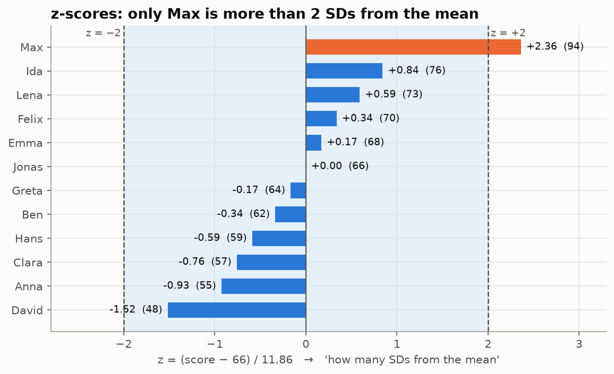
*Graph script: [`scripts/08-statistics/05_zscores.py`](scripts/08-statistics/05_zscores.py)*


### 3.2 Probabilities with a normal model (what Φ means)
Suppose from previous years: after-scores $\sim N(66,\,12^2)$, i.e. $\mu=66$, $\sigma=12$ (careful: written $N(66,144)$ the second number is the **variance**).

**Question:** what fraction of students score at most 78? In symbols $P(X\le78)$, and the formula says
$$P(X\le x)=\Phi\!\left(\frac{x-\mu}{\sigma}\right).$$

**Read it from the inside out:**

1. **$\frac{x-\mu}{\sigma}$ converts the score to a z-value**, i.e. "how many SDs above the mean": $\frac{78-66}{12}=\frac{12}{12}=1$. So 78 is exactly **1 SD above** average.
2. **$\Phi(z)$ is the area under the standard bell curve $N(0,1)$ to the left of $z$**, meaning the share of the population below $z$. You look it up in the table: $\Phi(1)=0.8413$.
3. **Result:** $P(X\le78)=\Phi(1)=0.8413$, so 84% of students score 78 or less.

**Why can one table work for every normal distribution?** Standardizing only re-labels the x-axis (66→0, 78→1, 90→2, …). The shape is the same, so **the shaded area is the same**: compare panels (a) and (b) below. That's why tables list only $N(0,1)$.

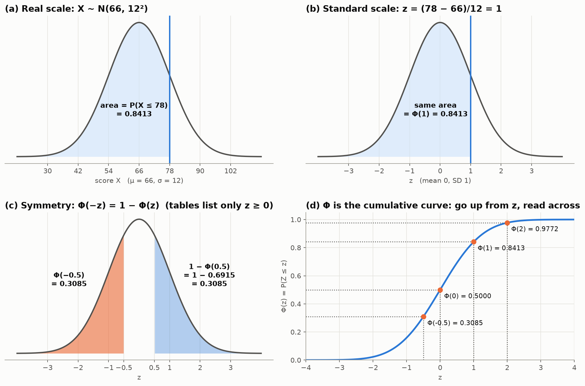
*Graph script: [`scripts/08-statistics/15_phi_standardization.py`](scripts/08-statistics/15_phi_standardization.py)*

**Facts about Φ** (see panels c and d):
- $\Phi(z)$ is a probability, so $0\le\Phi(z)\le1$; it increases with $z$.
- $\Phi(0)=0.5$: half the bell is left of the centre.
- **Symmetry:** $\Phi(-z)=1-\Phi(z)$. The left tail below $-z$ equals the right tail above $+z$. Tables list only $z\ge0$, so you use this for negative $z$.
- $\Phi$ is the **CDF** (cumulative distribution function) of $N(0,1)$; panel (d) is the curve, the table is the same curve written as numbers.

**The three cases on our scores** (always standardize first):

| Question | Standardize | Formula | Result |
|---|---|---|---|
| $P(\text{score}\le78)$, left area | $z=\frac{78-66}{12}=1$ | $\Phi(1)$ | **0.8413** |
| $P(\text{score}>90)$, right area | $z=\frac{90-66}{12}=2$ | $1-\Phi(2)=1-0.9772$ | **0.0228** (≈2%) |
| $P(54<\text{score}<78)$, middle area | $z_1=\frac{54-66}{12}=-1$, $z_2=1$ | $\Phi(1)-\Phi(-1)=\Phi(1)-(1-\Phi(1))=2\Phi(1)-1$ | **0.6826** (the "68%" rule) |
| $P(\text{score}<60)$, negative $z$ | $z=\frac{60-66}{12}=-0.5$ | $\Phi(-0.5)=1-\Phi(0.5)=1-0.6915$ | **0.3085** → ≈31% expected to fail |

**Going backwards (from area to score):** "Which score do the top 2.5% beat?" We need $\Phi(z)=0.975$. The table gives $z=1.96$, so $x=\mu+z\sigma=66+1.96\cdot12=89.5$. Similarly 95% of students lie in $66\pm1.96\cdot12=[42.5,\ 89.5]$.

> **Exam recipe:** (1) draw the bell, shade what is asked; (2) $z=\frac{x-\mu}\sigma$; (3) left area → $\Phi(z)$, right area → $1-\Phi(z)$, middle → $\Phi(z_2)-\Phi(z_1)$; (4) negative $z$ → $1-\Phi(\lvert z\rvert)$.

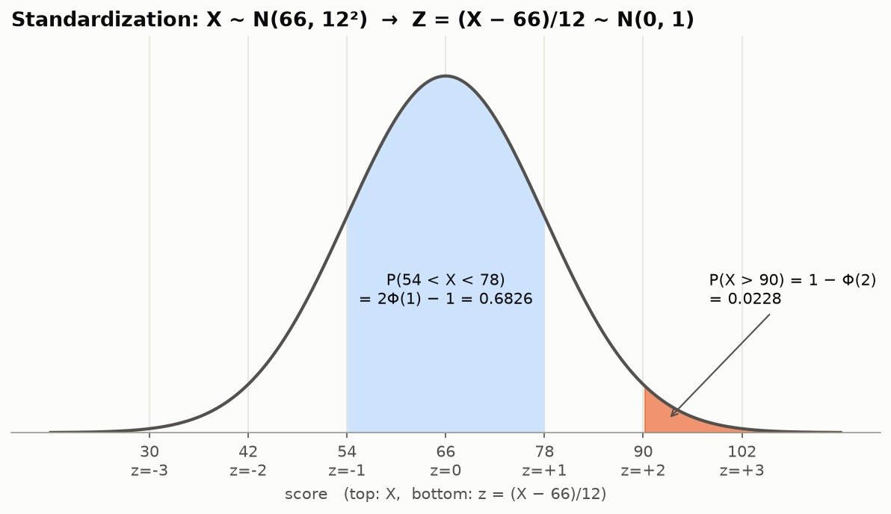
*Graph script: [`scripts/08-statistics/08_normal_curve.py`](scripts/08-statistics/08_normal_curve.py)*


### 3.3 Is `score_after` normal? (Q–Q idea / KS test)
Compare the empirical CDF $F_n$ with the fitted $N(66,11.86^2)$ CDF. The largest gap is at $x=70$: $F_n(70)=\frac9{12}=0.75$ vs $F_0(70)=\Phi\!\left(\frac{4}{11.86}\right)=\Phi(0.337)=0.632$, so $D=0.118$. Approximate 5% critical value $\frac{1.36}{\sqrt{12}}=0.39$ → **no evidence against normality** (Shapiro–Wilk $p=0.59$ agrees). With $n=12$ such tests have little power, so "not rejected" ≠ "proven normal".

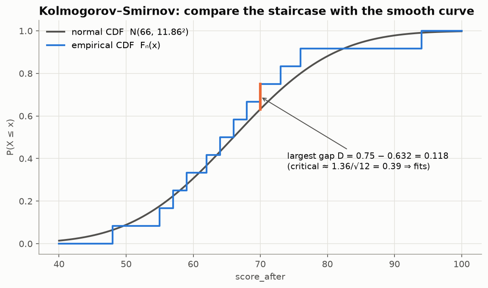
*Graph script: [`scripts/08-statistics/13_ecdf_ks.py`](scripts/08-statistics/13_ecdf_ks.py)*


---

## 4. Estimators and unbiasedness

| Parameter | Estimator | Value from data |
|---|---|---|
| $\mu$ (mean score) | $\bar X$ — unbiased | 66 |
| $\sigma^2$ | $S^2=\frac1{n-1}\sum(X_i-\bar X)^2$ — **unbiased** | 140.73 |
| $\sigma^2$ | $\frac1n\sum(\ldots)^2$ = normal MLE — **biased** (too small on average) | 129 |
| $\sigma$ | $S$ — slightly biased (Jensen), still used | 11.86 |
| SE of $\bar X$ | $\frac s{\sqrt n}=\frac{11.86}{\sqrt{12}}$ | 3.42 |

**Bias of the $1/n$ version:** $E\left[\frac1n\sum\right]=\frac{n-1}n\sigma^2=\frac{11}{12}\sigma^2$; here $129=\frac{11}{12}\cdot140.73$ exactly. Bessel's correction ($n-1$) removes this.

Simulation: draw 20 000 classes of 12 students from $N(66,12^2)$ (true $\sigma^2=144$) and estimate the variance each time:

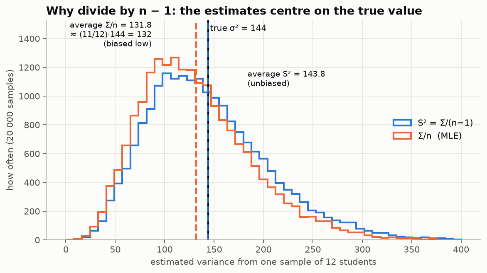
*Graph script: [`scripts/08-statistics/14_estimator_bias.py`](scripts/08-statistics/14_estimator_bias.py)*


**Standard error meaning:** if we repeated the study with new 12 students, $\bar x$ would typically move by about 3.4 points. With 48 students (4×) the SE would halve to ≈1.7.

### 4.1 Maximum likelihood on the dataset
| Model | MLE formula | Our data |
|---|---|---|
| `absences` ~ Poisson$(\lambda)$ | $\hat\lambda=\bar x$ | $\hat\lambda=1.25$ |
| `passed` ~ Bernoulli$(p)$ | $\hat p=\bar x$ | $\hat p=\frac8{12}=0.667$ |
| `study_hours` ~ Exponential$(\lambda)$ | $\hat\lambda=\frac1{\bar x}$ | $\frac1{4.75}=0.211$ per hour |
| `score_after` ~ $N(\mu,\sigma^2)$ | $\hat\mu=\bar x$, $\hat\sigma^2=\frac1n\sum$ | $66$, $129$ |

**Exponential derivation:** $\log L=n\log\lambda-\lambda\sum x_i=12\log\lambda-57\lambda$; derivative $\frac{12}\lambda-57=0$ ⇒ $\hat\lambda=\frac{12}{57}=0.211$.

### 4.2 $U[0,\theta]$ example: maximum possible study hours
Model `study_hours` $\sim U[0,\theta]$ and estimate the upper limit $\theta$:
- MLE: $\hat\theta=\max x_i=12$ — **biased low** (the true max can never be below the sample max), $E=\frac n{n+1}\theta$
- Bias-corrected: $\frac{n+1}n\max x_i=\frac{13}{12}\cdot12=\mathbf{13}$ — unbiased
- Method of moments: $E[X]=\frac\theta2$ ⇒ $\hat\theta=2\bar x=9.5$ — unbiased, but here it is **below** an observed value (12)! Unbiased does not mean every estimate is sensible; it has larger variance than the corrected max.

**MSE** $=\operatorname{Var}+\text{bias}^2$: that is why a slightly biased estimator can still beat an unbiased one.

---

## 5. Confidence intervals

All for `score_after`: $\bar x=66$, $s=11.86$, $n=12$.

### 5.1 Mean, σ known ($\sigma=12$) — $z$-interval, 95%
$SE=\frac{12}{\sqrt{12}}=3.464$; $66\pm1.96\cdot3.464=66\pm6.79$ ⇒ $\mathbf{[59.21,\ 72.79]}$

### 5.2 Mean, σ unknown — $t$-interval, 95%
$SE=\frac{11.86}{\sqrt{12}}=3.425$, df $=11$, $t_{11,0.975}=2.201$
$66\pm2.201\cdot3.425=66\pm7.54$ ⇒ $\mathbf{[58.46,\ 73.54]}$
Wider than the $z$-interval: we pay for not knowing σ.

### 5.3 Proportion who passed, 95%
$\hat p=\frac8{12}=0.667$, $SE=\sqrt{\frac{0.667\cdot0.333}{12}}=0.136$
$0.667\pm1.96\cdot0.136$ ⇒ $\mathbf{[0.40,\ 0.93]}$ — very wide because $n$ is small (and $n\hat p(1-\hat p)=2.7$ is below the usual rule of thumb, so treat it as rough).

### 5.4 Variance, 95% (normal data)
df $=11$, $\chi^2_{11,0.025}=3.816$, $\chi^2_{11,0.975}=21.920$, $(n-1)s^2=1548$
$$\left[\frac{1548}{21.920},\ \frac{1548}{3.816}\right]=\mathbf{[70.6,\ 405.7]}\quad\Rightarrow\ \sigma\in[8.4,\ 20.1]$$
Not symmetric around $s^2$ (the $\chi^2$ distribution is skewed).

### 5.5 Effects on width and sample size
- 99% instead of 95% ($z$-case): $66\pm2.576\cdot3.464=[57.08,\ 74.92]$ → wider.
- 90%: $66\pm1.645\cdot3.464=[60.30,\ 71.70]$ → narrower.
- **Sample size** for margin $E=5$ with $\sigma=12$ at 95%: $n=\left(\frac{1.96\cdot12}{5}\right)^2=22.1$ ⇒ **23 students** (round up).
- To halve the margin (6.79 → 3.39) we need $4\cdot12=48$ students.

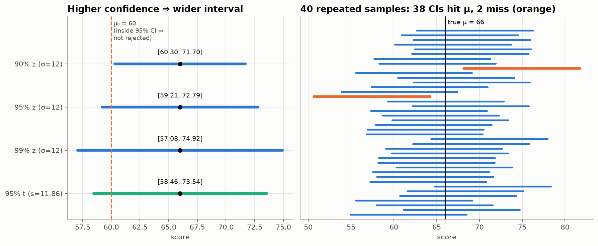
*Graph script: [`scripts/08-statistics/09_confidence_intervals.py`](scripts/08-statistics/09_confidence_intervals.py)*

**Interpretation of [58.46, 73.54]:** if we repeated this study many times, 95% of intervals built this way would contain the true mean score μ. It does **not** say 95% of students score in this range (individual scores range 48–94).

---

## 6. Hypothesis tests and p-values

**Question:** the school's long-run average after-score is 60. Is this year's class different?

1. $H_0:\mu=60$, $H_1:\mu\ne60$ (two-sided)
2. $\alpha=0.05$, chosen before looking.
3. Test statistic (σ = 12 known): $z=\frac{66-60}{12/\sqrt{12}}=\frac6{3.464}=\mathbf{1.73}$
4. Critical value $1.96$; $\lvert z\rvert=1.73<1.96$. p-value $=2(1-\Phi(1.73))=2(1-0.9584)=\mathbf{0.083}$
5. $p=0.083>0.05$ ⇒ **do not reject $H_0$**.

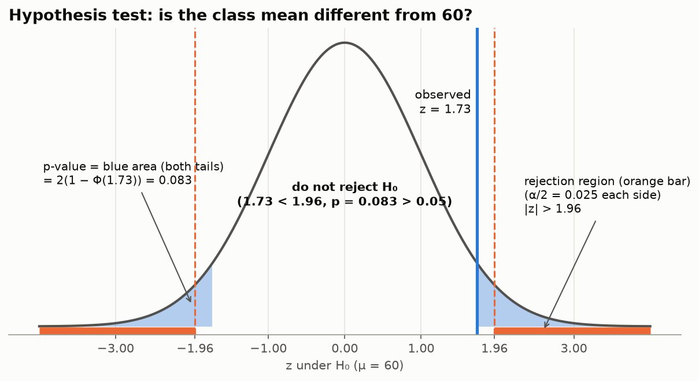
*Graph script: [`scripts/08-statistics/10_hypothesis_test.py`](scripts/08-statistics/10_hypothesis_test.py)*


**Meaning of $p=0.083$:** *if* the true mean were 60, a sample mean at least 6 points away would happen about 8.3% of the time. That is not rare enough at the 5% level. It is **not** "the probability that $H_0$ is true".

- One-sided test ($H_1:\mu>60$): $p=1-0.9584=0.042<0.05$ ⇒ would reject. The direction must be chosen **before** seeing the data.
- At $\alpha=0.10$: reject (two-sided), since $0.083\le0.10$.
- **CI–test duality:** 60 lies inside the 95% $z$-CI $[59.21,72.79]$ ⇒ not rejected — the same answer.

**Errors in this story**

| | true mean really 60 | true mean ≠ 60 |
|---|---|---|
| we reject | **Type I** (prob. $\alpha=0.05$): we claim the class is different, but it isn't | correct (**power** $1-\beta$) |
| we don't reject | correct | **Type II** ($\beta$): the class is better but we missed it — possible here, since $n=12$ is small |

Power would increase with more students, a larger true difference, smaller σ, or larger α.

**Multiple testing:** if we compared the three methods pairwise (3 tests), Bonferroni uses $\frac{0.05}3=0.0167$ per test.

---

## 7. Parametric tests

### 7.1 One-sample $t$-test (σ unknown)
$H_0:\mu=60$. $t=\frac{66-60}{11.86/\sqrt{12}}=\frac6{3.425}=\mathbf{1.75}$, df 11, critical $2.201$, $p=0.108$ ⇒ do not reject. ($t$ gives a larger p than $z$: heavier tails.)

### 7.2 Paired $t$-test — did the course help? (`score_before` → `score_after`)
Differences $d_i=\text{after}-\text{before}$:

| name | Anna | Ben | Clara | David | Emma | Felix | Greta | Hans | Ida | Jonas | Lena | Max |
|---|---|---|---|---|---|---|---|---|---|---|---|---|
| $d_i$ | 3 | 4 | 7 | 3 | 8 | 7 | 9 | **−2** | 11 | 5 | 11 | 24 |

$\bar d=\frac{90}{12}=7.5$, $s_d=6.39$, $SE=\frac{6.39}{\sqrt{12}}=1.844$
$H_0:\mu_d=0$. $t=\frac{7.5}{1.844}=\mathbf{4.07}$, df 11, critical $2.201$, $p=0.0019$ ⇒ **reject $H_0$**: scores improved significantly (on average +7.5 points).
Why paired? The same students are measured twice; pairing removes the student-to-student differences.

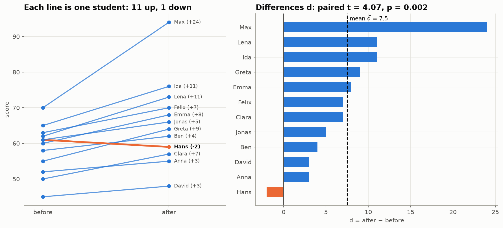
*Graph script: [`scripts/08-statistics/11_paired_before_after.py`](scripts/08-statistics/11_paired_before_after.py)*


### 7.3 Two-sample $t$-test — do girls and boys differ? (`gender`)
| | scores | $n$ | mean | $s^2$ |
|---|---|---|---|---|
| F | 55, 57, 68, 64, 76, 73 | 6 | 65.5 | 71.5 |
| M | 62, 48, 70, 59, 66, 94 | 6 | 66.5 | 237.5 |

Pooled variance $s_p^2=\frac{5\cdot71.5+5\cdot237.5}{10}=154.5$, $s_p=12.43$
$t=\frac{65.5-66.5}{12.43\sqrt{\frac16+\frac16}}=\frac{-1}{7.18}=\mathbf{-0.14}$, df 10, critical $2.228$, $p=0.89$ ⇒ no difference. (Welch's test gives the same conclusion.)

### 7.4 $F$-test — equal variances?
$F=\frac{s_M^2}{s_F^2}=\frac{237.5}{71.5}=\mathbf{3.32}$, df $(5,5)$, critical $F_{5,5,0.975}=7.15$ ⇒ do not reject equal variances (the boys' larger spread is mostly Max).

### 7.5 One-way ANOVA — do the three methods differ? (`method`)
| method | scores | mean | $\sum(x-\bar x_g)^2$ |
|---|---|---|---|
| Lecture | 55, 62, 57, 48 | 55.5 | 101 |
| Video | 68, 70, 64, 59 | 65.25 | 70.75 |
| Group | 76, 66, 73, 94 | 77.25 | 426.75 |

- Between groups: $SSB=4(55.5-66)^2+4(65.25-66)^2+4(77.25-66)^2=441+2.25+506.25=949.5$, df $=k-1=2$, $MSB=474.75$
- Within groups: $SSW=101+70.75+426.75=598.5$, df $=N-k=9$, $MSW=66.5$
- $F=\frac{474.75}{66.5}=\mathbf{7.14}$, critical $F_{2,9,0.95}=4.26$, $p=0.014$ ⇒ **reject**: at least one method has a different mean (Group looks best).

Check: $SSB+SSW=949.5+598.5=1548=$ total SS from section 1.2.

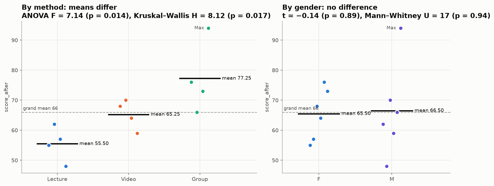
*Graph script: [`scripts/08-statistics/12_groups.py`](scripts/08-statistics/12_groups.py)*


### 7.6 $\chi^2$ variance test
$H_0:\sigma^2=144$ ($\sigma=12$). $\chi^2=\frac{(n-1)s^2}{\sigma_0^2}=\frac{1548}{144}=\mathbf{10.75}$, df 11; acceptance region $[3.82,\ 21.92]$ ⇒ do not reject — consistent with the variance CI $[70.6,405.7]$ containing 144.

### 7.7 $\chi^2$ test of independence — is passing related to method?
Observed (expected in brackets; $E=\frac{\text{row}\cdot\text{col}}{N}$):

| | passed yes | passed no | total |
|---|---|---|---|
| Lecture | 1 (2.67) | 3 (1.33) | 4 |
| Video | 3 (2.67) | 1 (1.33) | 4 |
| Group | 4 (2.67) | 0 (1.33) | 4 |
| total | 8 | 4 | 12 |

$\chi^2=\sum\frac{(O-E)^2}{E}=(1.042+2.083)+(0.042+0.083)+(0.667+1.333)=\mathbf{5.25}$
df $=(3-1)(2-1)=2$, critical $5.99$, $p=0.072$ ⇒ do not reject at 5%.
Caveat: all expected counts are $<5$, so the $\chi^2$ approximation is unreliable here; Fisher's exact test would be the proper choice. (The 2×2 table gender × passed is 4/2 vs 4/2, giving $\chi^2=0$ — perfectly independent.)

---

## 8. Non-parametric tests

Same questions as section 7, now using only **signs** or **ranks** — no normality needed.

### 8.1 Sign test (paired, before → after)
11 of 12 differences are positive (only Hans got worse). Under $H_0$: $S\sim\text{Bin}(12,\frac12)$.
One-sided $p=P(S\ge11)=\frac{\binom{12}{11}+\binom{12}{12}}{2^{12}}=\frac{13}{4096}=\mathbf{0.0032}$; two-sided $0.0063$ ⇒ **reject**: the course helped.

### 8.2 Wilcoxon signed-rank test (paired)
Rank $\lvert d_i\rvert$ (ties get the average rank):

| $\lvert d\rvert$ | 2 | 3 | 3 | 4 | 5 | 7 | 7 | 8 | 9 | 11 | 11 | 24 |
|---|---|---|---|---|---|---|---|---|---|---|---|---|
| sign | − | + | + | + | + | + | + | + | + | + | + | + |
| rank | 1 | 2.5 | 2.5 | 4 | 5 | 6.5 | 6.5 | 8 | 9 | 10.5 | 10.5 | 12 |

$W^-=1$ (only Hans), $W^+=77$ (check: $W^++W^-=\frac{12\cdot13}2=78$). Test statistic $W=\min=1$; critical value for $n=12$, two-sided 5%: $13$. $1\le13$ ⇒ **reject**, $p\approx0.001$. It uses magnitudes too, so it gives a smaller p than the sign test.

### 8.3 Mann–Whitney U (gender, independent samples)
Rank all 12 scores together (48→1, 55→2, …, 94→12):
- F ranks: 2, 3, 8, 6, 11, 10 → $R_F=40$; M ranks: 5, 1, 9, 4, 7, 12 → $R_M=38$
- $U_F=R_F-\frac{6\cdot7}2=40-21=19$, $U_M=38-21=17$ (check: $U_F+U_M=n_1n_2=36$; mean under $H_0$ is 18)
- $U=\min=17$; critical value ($n_1=n_2=6$, 5% two-sided) $=5$; $17>5$ ⇒ no difference, $p=0.94$. Same conclusion as the $t$-test.

### 8.4 Kruskal–Wallis (3 methods)
Rank sums: Lecture $2+5+3+1=11$, Video $8+9+6+4=27$, Group $11+7+10+12=40$ (total 78 ✓).
$$H=\frac{12}{N(N+1)}\sum\frac{R_j^2}{n_j}-3(N+1)=\frac{12}{156}\cdot\frac{121+729+1600}{4}-39=47.12-39=\mathbf{8.12}$$
Compare with $\chi^2_{2,0.95}=5.99$ ⇒ **reject**, $p=0.017$. Same conclusion as ANOVA, but not affected by Max's extreme 94 (it is simply rank 12).

### 8.5 Spearman rank correlation (hours vs score)
Ranks of hours: 2, 6, 3.5, 1, 8, 9.5, 6, 3.5, 11, 6, 9.5, 12; ranks of scores: 2, 5, 3, 1, 8, 9, 6, 4, 11, 7, 10, 12.
Pearson correlation of these ranks: $\rho=\mathbf{0.989}$ — a nearly perfect **monotone** relation. Pearson $r=0.990$ is similar here because the relation is also close to linear; Spearman would stay at 1 even for a curved but always-increasing relation.

### 8.6 Kolmogorov–Smirnov
Done in section 3.3: $D=0.118<0.39$ ⇒ normality not rejected.

### Parametric vs non-parametric on our data
| Question | Parametric | p | Non-parametric | p | Conclusion |
|---|---|---|---|---|---|
| Did scores improve? | paired $t$ | 0.0019 | sign / Wilcoxon | 0.0063 / 0.001 | yes |
| F vs M? | two-sample $t$ | 0.89 | Mann–Whitney | 0.94 | no difference |
| Methods differ? | ANOVA | 0.014 | Kruskal–Wallis | 0.017 | yes |
| hours ~ score? | Pearson $r$ | 0.990 | Spearman $\rho$ | 0.989 | strong + |

---

## 9. Summary

| Question about the dataset | Formula / test | Result |
|---|---|---|
| Typical after-score? | mean / median | 66 / 65 |
| How spread out? | $s^2$, $s$, IQR | 140.73, 11.86, 13.5 |
| Any unusual students? | $1.5\,IQR$ fences, z-score | Max: 94 (> 91.75), $z=2.36$ |
| Skewed? | skewness | 0.86 (right) |
| Expected absences? | $E[X]$, $\operatorname{Var}X$ | 1.25, 1.52 |
| $P(\text{score}>90)$ under $N(66,12^2)$ | $1-\Phi(z)$ | 0.0228 |
| Range for true mean? | $t$-CI | [58.46, 73.54] |
| Different from 60? | $z$ / $t$ test | $p=0.083$ / $0.108$ → no |
| Did the course help? | paired $t$, sign, Wilcoxon | yes ($p<0.01$) |
| Gender effect? | $t$, Mann–Whitney | no |
| Method effect? | ANOVA, Kruskal–Wallis | yes ($p\approx0.015$) |
| Hours vs score? | Pearson, Spearman, regression | $r=0.99$, $\hat y=46.53+4.10x$ |
| Passing vs method? | $\chi^2$ independence, df 2 | 5.25, $p=0.07$ (counts too small) |

**Try it yourself (Python check):**
```python
import pandas as pd
from scipy import stats
df = pd.read_csv("08-statistics-students.csv")
a = df.score_after
print(a.mean(), a.median(), a.var(ddof=1), a.std(ddof=1))
print(stats.ttest_rel(df.score_after, df.score_before))
print(stats.f_oneway(*[g.score_after for _, g in df.groupby("method")]))
print(stats.kruskal(*[g.score_after for _, g in df.groupby("method")]))
```

---

## Regenerating the graphs

All graphs are produced by the scripts in [`scripts/08-statistics/`](scripts/08-statistics/) from [`08-statistics-students.csv`](08-statistics-students.csv) and saved to [`images/08-statistics/`](images/08-statistics/). Change the CSV, rerun, and every picture updates.

```bash
# all graphs at once (from the repo root)
uv run --no-project --with matplotlib --with numpy --with scipy \
    python scripts/08-statistics/make_all.py

# or a single one
uv run --no-project --with matplotlib --with numpy --with scipy \
    python scripts/08-statistics/01_outliers_number_line.py
```

| Graph | Topic | Script |
|---|---|---|
| 01 outliers on a number line | IQR, fences, outliers | [`01_outliers_number_line.py`](scripts/08-statistics/01_outliers_number_line.py) |
| 02 boxplot anatomy | five-number summary | [`02_boxplot_anatomy.py`](scripts/08-statistics/02_boxplot_anatomy.py) |
| 03 effect of one outlier | robustness of mean / median / SD | [`03_outlier_effect.py`](scripts/08-statistics/03_outlier_effect.py) |
| 04 histogram | shape, skewness | [`04_histogram_skew.py`](scripts/08-statistics/04_histogram_skew.py) |
| 05 z-scores | standardization | [`05_zscores.py`](scripts/08-statistics/05_zscores.py) |
| 06 scatter + regression | correlation, least squares, leverage | [`06_scatter_regression.py`](scripts/08-statistics/06_scatter_regression.py) |
| 07 absences distribution | $E[X]$, $\operatorname{Var}X$ | [`07_absences_pmf.py`](scripts/08-statistics/07_absences_pmf.py) |
| 08 normal curve | $\Phi$, probabilities | [`08_normal_curve.py`](scripts/08-statistics/08_normal_curve.py) |
| 09 confidence intervals | CI width, meaning of 95% | [`09_confidence_intervals.py`](scripts/08-statistics/09_confidence_intervals.py) |
| 10 hypothesis test | rejection region, p-value | [`10_hypothesis_test.py`](scripts/08-statistics/10_hypothesis_test.py) |
| 11 before / after | paired $t$, sign, Wilcoxon | [`11_paired_before_after.py`](scripts/08-statistics/11_paired_before_after.py) |
| 12 groups | ANOVA, Kruskal–Wallis, $t$, Mann–Whitney | [`12_groups.py`](scripts/08-statistics/12_groups.py) |
| 13 ECDF vs normal | Kolmogorov–Smirnov | [`13_ecdf_ks.py`](scripts/08-statistics/13_ecdf_ks.py) |
| 14 estimator bias | why $n-1$ | [`14_estimator_bias.py`](scripts/08-statistics/14_estimator_bias.py) |
| 15 what Φ means | standardization, $\Phi$, symmetry, CDF | [`15_phi_standardization.py`](scripts/08-statistics/15_phi_standardization.py) |
